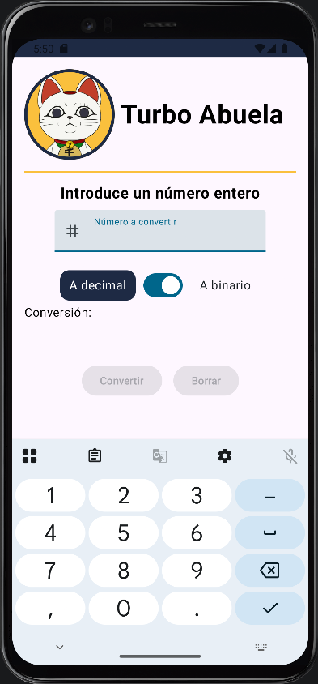
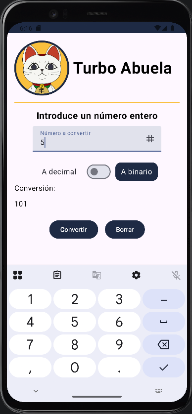
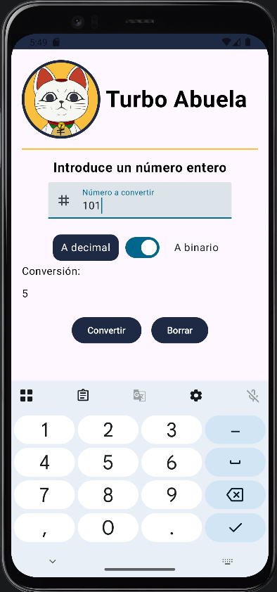

# 🔄 ConverterV2 - Conversor a binario

Aplicación Android desarrollada en Kotlin para la asignatura Programación Multimedia y Dispositivos Móviles (PMDM) del ciclo de Desarrollo de Aplicaciones Multiplataforma (DAM).

## 📃 Descripción

La aplicación permite realizar conversiones numéricas entre sistemas decimal y binario, mostrando además un teclado para introducir el número a convertir.

## ⚙️ Funcionalidades

- Foto de perfil circular con borde de color
- Nombre de usuario
- Campo de texto numérico que filtra la entrada automáticamente, permitiendo solo dígitos.
- Selector interactivo para alternar entre conversión a decimal o a binario.
- Botón de conversión que valida la entrada, calcula el valor y gestiona números no válidos.
- Botón de borrado para limpiar tanto el campo de texto como el resultado.
- El botón de conversión permanece deshabilitado si no hay número a convertir.
- El botón de borrado permanece deshabilitado si no hay número a convertir ni resultado.

## 🛠️ Tecnologías

- Kotlin
- Jetpack Compone + Material 3
- Android Studio
- `remember` y `mutableStateOf` para guardar el estado de la interfaz
- `TextField` para introducir el número
- `Switch`y `Card` para el selector interactivo

## 🎯 Objetivo

Practicar el diseño de interfaces Android con Compose combinando los componentes básicos (`Column`, `Row`, `Image`, `Text`, `Button`, `TextField`, `Switch`, `Card`), la gestión del estado y la implementación de lógica de conversión matemática entre bases numéricas.

### 🗂️ Estructura del proyecto

La lógica está en la función composable HomeScreen. Los textos están en strings.xml, los colores en colors.xml y las imágenes en la carpeta res/drawable.

## ▶️ Cómo ejecutarlo

Requisitos

    Android Studio (versión reciente)
    JDK 21
    Android SDK con minSdk 27

Pasos

    Clona el repositorio.
    Abre Android Studio y selecciona Open.
    Selecciona la carpeta ProfileYou del proyecto clonado.
    Espera que sincronice Gradle y se descarguen las dependencias necesarias.
    Selecciona un emulador Android o conecta un dispositivo físico con la depuración USB activada.
    Pulsa el botón ▶️ Run de Android Studio para compilar y ejecutar la aplicación.

### 📱 Capturas de pantalla

| Sin datos | A binario | A decimal
| --- | --- |
| | | 

### 👩‍💻 Autora
Sara Alós Plaza - 2º DAM <2026/2027>