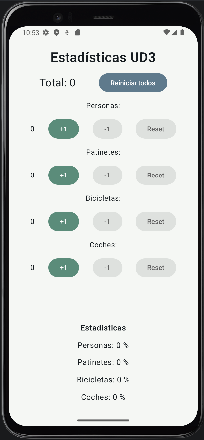
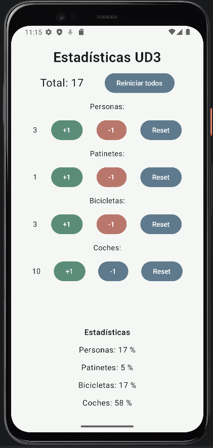

# 📊 Estadísticas - Control de acceso

Aplicación Android desarrollada en Kotlin para la asignatura **Programación Multimedia y Dispositivos Móviles (PMDM)** del ciclo de Desarrollo de Aplicaciones Multiplataforma (DAM).

## 📃 Descripción

La aplicación permite llevar el control estadístico del acceso a una calle mediante contadores para diferentes tipos de personas y vehículos, mnostrando además el porcentaje de cada categoría respecto al total.

## ⚙️ Funcionalidades

- Contadores independientes para personas, patinetes, bicicletas y coches. 
- Botón para aumentar cada contador en una unidad.
- Botón para disminuir cada contador en una unidad.
- Botón para reiniciar cada contador.
- Contador global con la suma de todos los contadores.
- Botón general para reiniciar todos los contadores.
- Porcentaje de cada categoría respecto al total.
- Los botones para disminuir o reiniciar de cada categoría permanecen deshabilitados si el contador está a cero.
- Los contadores se conservan al rotar la pantalla.

## 🛠️ Tecnologías

- Kotlin
- Jetpack Compone + Material 3
- Android Studio
- Propiedad `rememberSaveable` para conservar el estado al rotar la pantalla
- Propiedad `enabled` para controlar el estado de los botones

## 🎯 Objetivo

Practicar el desarrollo de interfaces Android con Compose, la gestión del estado, el cálculo de porcentajes y el uso de `enabled` para habilitar o deshabilitar botones.

### 🗂️ Estructura del proyecto
La lógica y la interfaz están en `MainActivity.kt`, dentro de la función composable `Content`. 
Los textos están en `strings.xml`y los colores en `colors.xml`.

## ▶️ Cómo ejecutarlo

**Requisitos**

- Android Studio (versión reciente)
- JDK 21
- Android SDK con `minSdk` 27

**Pasos**

1. Clona el repositorio.
2. Abre Android Studio y selecciona **Open**.
3. Selecciona la carpeta `Estadisticas` del proyecto clonado.
4. Espera que sincronice Gradle y se descarguen las dependencias necesarias.
5. Selecciona un emulador Android o conecta un dispositivo físico con la depuración USB activada.
6. Pulsa el botón ▶️ **Run** de Android Studio para compilar y ejecutar la aplicación.

### 📱 Capturas de pantalla

| Contadores a cero | Con datos |
| --- | --- |
| | |

### 👩‍💻 Autora
Sara Alós Plaza - 2º DAM <2026/2027>