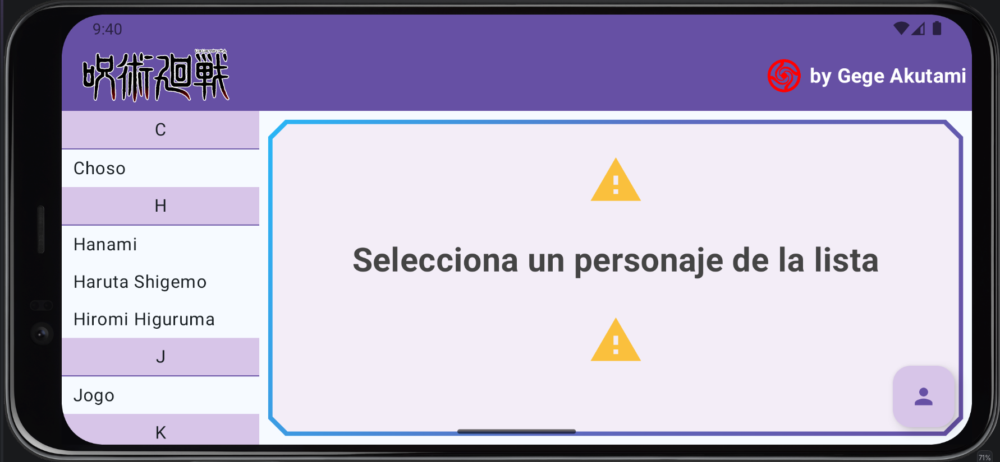
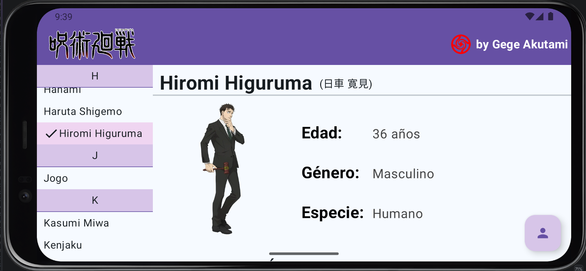
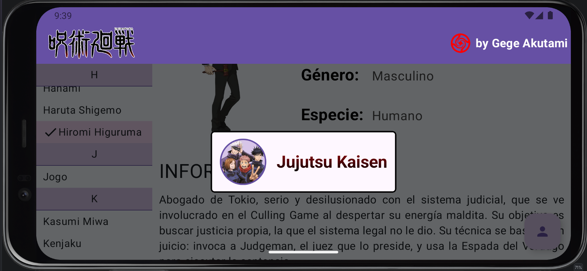

# 🌀 Master - Guía de personajes

Aplicación Android desarrollada en Kotlin para la asignatura **Programación Multimedia y Dispositivos Móviles (PMDM)** del ciclo de Desarrollo de Aplicaciones Multiplataforma (DAM).

## 📃 Descripción

La aplicación es una guía de personajes pensada en pantalla horizontal. A la izquierda muestra una lista de personajes ordenada alfabéticamente y agrupada por inicial, y a la derecha el detalle del personaje seleccionado, con su imagen, sus datos y su descripción. Un botón flotante abre una ventana con la información del perfil.

## ⚙️ Funcionalidades

- Barra superior con el logo de la serie y el logo con el nombre del creador.
- Lista de 23 personajes ordenador por nombre y agrupados por inicial, con cabeceras fijas al hacer scroll.
- El personaje seleccionado se resalta con otro color y un icono de check.
- Tarjeta de aviso con borde degradado y esquinas cortadas mientras no hay ningún personaje seleccionado.
- Detalle del personaje con nombre, nombre original en japonés, imagen, edad, género, especie y descripción.
- La zona de detalle tiene scroll vertical para las descripciones.
- Botón flotante (FAB) fijo en la esquina inferior derecha que abre una ventana de perfil sobre un fondo semitransparente. La ventana tiene una foto circular con borde y un texto con degradado, y se cierra al pulsar fuera de ella.

## 🛠️ Tecnologías

- Kotlin
- Jetpack Compone + Material 3
- Android Studio
- `remember` y `mutableStateOf` para guardar el estado de la interfaz (personaje seleccionado y ventana de perfil)
- `LazyColumn`con `stickyHeader`para la lista agrupada.
- `Card` para la tarjeta de aviso y el cuadro de la ventana de perfil.
- `CutCornerShape`y `Brush` para las esquinas cortadas y los degradados de bordes y del texto.
- `FloatingActionButton` y `Box` para superponer la ventana de perfil al contenido.
- `data class` con `companion object` para guardar los datos de los personajes.

## 🎯 Objetivo

Practicar el diseño de interfaces Android con Compose combinando listas, detalle y superposiciones: el patrón lista-detalle, la elevación del estado (*state hoisting*), la división de la interfaz en composables pequeños y el uso de recursos de la app (textos, colores e imágenes).

### 🗂️ Estructura del proyecto

La interfaz se divide en composables, cada uno con una única responsabilidad:

| Composable | Función |
| --- | --- |
| `HomeScreen` | Pantalla principal. Guarda el estado (`seleccionada`, `mostrarInfo`) y organiza el resto. |
| `HomeTopBar` | Barra superior con los dos logos. |
| `CharacterList` | Lista agrupada por inicial con cabeceras fijas y marca de selección. |
| `CharacterDetail` | Detalle del personaje seleccionado. |
| `InfoRow` | Fila con etiqueta y valor (Edad, Género, Especie). |
| `EmptyDetail` | Tarjeta que se muestra si no hay personaje seleccionado. |
| `Profile` | Ventana de perfil que abre el botón flotante. |

Los datos de los personajes están en la clase `Character` (`id`, `nombre`, `real`, `imagen`, `edad`, `genero`, `especie`, `info`), dentro del paquete `model`. Los textos están en `strings.xml`, los colores en `colors.xml` y las imágenes en la carpeta `res/drawable`.

## ▶️ Cómo ejecutarlo

**Requisitos**

- Android Studio (versión reciente)
- JDK 21
- Android SDK con `minSdk` 27

**Pasos**

1. Clona el repositorio.
2. Abre Android Studio y selecciona **Open**.
3. Selecciona la carpeta `Master` del proyecto clonado.
4. Espera que sincronice Gradle y se descarguen las dependencias necesarias.
5. Selecciona un emulador Android o conecta un dispositivo físico con la depuración USB activada.
6. Pulsa el botón ▶️ **Run** de Android Studio para compilar y ejecutar la aplicación.

### 📱 Capturas de pantalla

| Pantalla | Captura |
| --- | --- |
| Sin selección |  |
| Personaje seleccionado |  |
| Ventana de perfil |  |

### 👩‍💻 Autora
Sara Alós Plaza - 2º DAM <2026/2027>