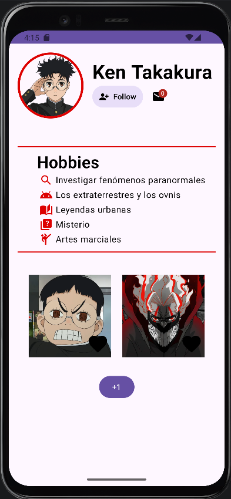
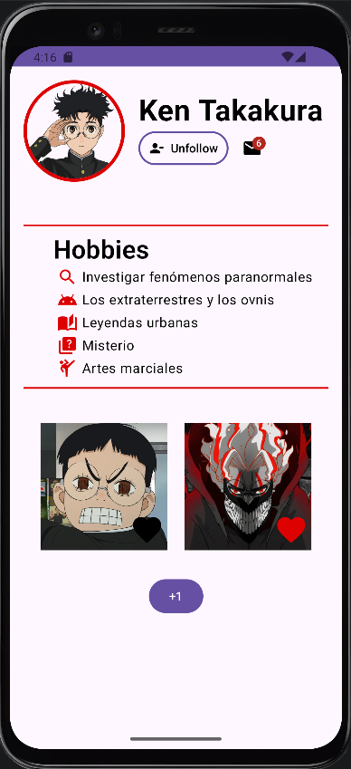

# 📊 ProfileYou - Perfil de usuario

Aplicación Android desarrollada en Kotlin para la asignatura **Programación Multimedia y Dispositivos Móviles (PMDM)** del ciclo de Desarrollo de Aplicaciones Multiplataforma (DAM).

## 📃 Descripción

La aplicación muestra una pantalla de perfil de usuario de una red social con foto, nombre, lista de hobbies, botón de seguir, dos imágenes con botón de like y un icono de correo con el número de mensajes sin leer.

## ⚙️ Funcionalidades

- Foto de perfil circular con borde de color.
- Nombre del usuario.
- Botón que alterna entre **Follow** y **Unfollow**, cambiando también su icono y color.
- Icono de sobre con `BadgeBox`que muestra el número de mensajes sin leer.
- Botón **+** que incrementa el contador de mensajes en una unidad.
- Lista de hobbies, cada uno con un icono delante.
- Dos imágenes con un botón de corazón para dar o quitar like de forma independiente. El corazón se pinta de rojo cuando está activado.

## 🛠️ Tecnologías

- Kotlin
- Jetpack Compone + Material 3
- Android Studio
- `remember` y `mutableStateOf` para guardar el estado de la interfaz (seguir, likes, mensajes)
- `Badgebox` y `Badge` para mostrar el contador sobre el icono
- `IconToggleButton` para los botones de like

## 🎯 Objetivo

Practicar el diseño de interfaces Android con Compose combinando los componentes básicos (`Column`, `Row`, `Box`, `Image`, `Text`, `Button`, `Icon`, `Spacer`, `HorizontalDivider`), la gestión del estado y los recursos de la app (textos, colores e imágenes).

### 🗂️ Estructura del proyecto
La lógica está en la función composable `HomeScreen`.
Los textos están en `strings.xml`, los colores en `colors.xml` y las imágenes en la carpeta `res/drawable`.

## ▶️ Cómo ejecutarlo

**Requisitos**

- Android Studio (versión reciente)
- JDK 21
- Android SDK con `minSdk` 27

**Pasos**

1. Clona el repositorio.
2. Abre Android Studio y selecciona **Open**.
3. Selecciona la carpeta `ProfileYou` del proyecto clonado.
4. Espera que sincronice Gradle y se descarguen las dependencias necesarias.
5. Selecciona un emulador Android o conecta un dispositivo físico con la depuración USB activada.
6. Pulsa el botón ▶️ **Run** de Android Studio para compilar y ejecutar la aplicación.

### 📱 Capturas de pantalla

| Perfil inicial | Siguiendo, con likes y mensajes |
| --- | --- |
| | |

### 👩‍💻 Autora
Sara Alós Plaza - 2º DAM <2026/2027>